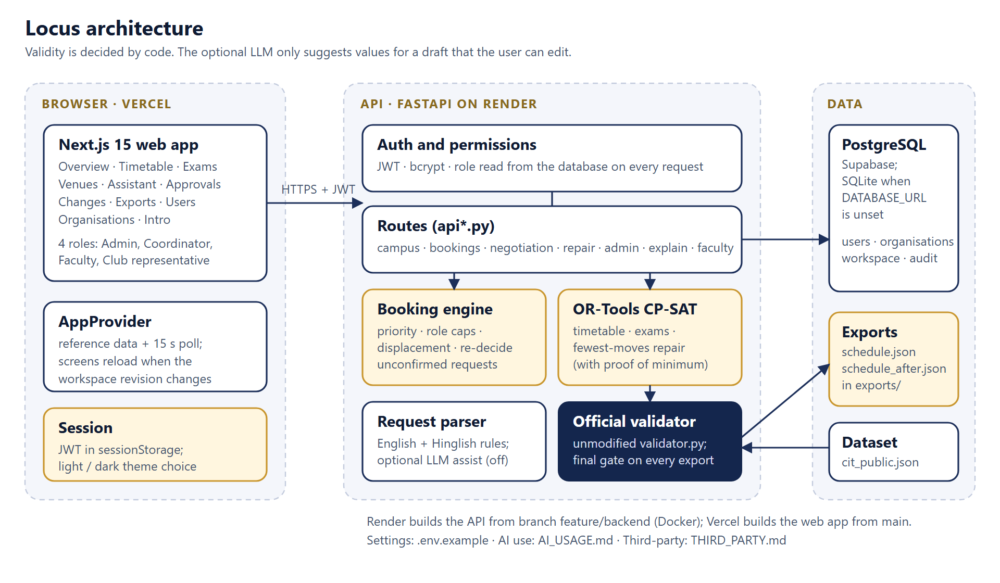

# LocusCIT - Campus Scheduling and Venue Management

Crunch Week, TechZephyr 4.0 (IIT Bhubaneswar). A role-aware platform for the Chilika Institute of Technology (CIT) that
generates the semester timetable and midsem exams, decides Spectra-week venue bookings by priority, accepts
English/Hinglish booking requests, repairs the timetable after a change with the fewest moved sessions, and
applies a change only after an Admin has reviewed the suggested shifting, with the reason for every move, and approved it. Every schedule is checked by the **official validator** before it is saved.

## **Demo video (5 min): https://youtu.be/0lar-6GRyu0**

## **Live app: https://locus-cit.vercel.app**

* **Video walkthrough:** https://youtu.be/0lar-6GRyu0
* **Live app:** https://locus-cit.vercel.app
* **Repository:** https://github.com/bharathvaj125/LocusCIT
* API: https://locuscit.onrender.com (health: `/api/health`, docs: `/docs`)

> The API runs on a free server that sleeps after 15 minutes idle. If the first screen says it is waking up, wait about a
> minute; the page retries by itself.

## Sign in (demo accounts, same on the live site)
| Role | Username | Password | What this account is for |
| --- | --- | --- | --- |
| Admin | `admin1` | `Admin@123` | generates the timetable, exams and decisions, proposes changes, exports, decides requests |
| Department coordinator | `coordinator1` | `Coord@123` | CSE department: decides bookings of CSE labs, requests changes to CSE sessions |
| Faculty | `faculty1` | `Faculty@123` | Dr. Arjun Mehta (F06): own timetable, marks unavailability, asks to move a class or add an extra session |
| Club representative | `club1` | `Club@123` | Dramatics Society: requests venues and follows their status |

The login page has one-click buttons for all four. Every role sees the same **Overview** (campus numbers, "Is a room free?"
and approved events) and can read any timetable; only requests and approvals are private to the people involved.

## A first visit, in order (about 10 minutes)
**1. Set up as `admin1` (Overview page).** Press *Run again* on each step if a step is not done:
*Generate the timetable* (for the official dataset it starts from the saved best timetable and re-checks it with the official validator, a few seconds; for any other dataset it is solved from scratch, which takes longer), *Schedule midsem exams*, *Decide Spectra requests*.
For a clean start press *Reset demo data* (Overview, "Start over" card), then run the three steps again.

**2. Find a room.** Any account: *Overview > Campus at a glance > Is a room free?* Pick a day, a time range and the seats you need.
Free rooms are listed; open "taken rooms" to see what holds the others. *Venues & Spectra > Venue board* shows the same as a grid
(hover the (i) on a closed room for the reason).

**Look and feel.** The app opens with a short intro (skip it with the button; replay it from the account menu), then the sign-in page. Pages are in the dock at the bottom of the screen: one icon and name per page, and the page you are on is the gold capsule (arrow keys move between pages; on a phone the dock scrolls sideways). Pages you have already opened stay loaded, so switching between them is instant. Your name and role are top right, with the account menu (switch demo account, replay the intro, sign out) and the sun/moon menu that switches between Light, Dark and "match my device"; that choice is remembered in your browser.

**3. Read a timetable.** *Timetable* in the menu. Choose *Student group*, *Faculty* or *Room* and an item; click a class to see why it is there. The switch at the top has two modes: *Regular weeks*, and *Week 7 · Spectra*, which shows the same grid with approved events (evenings up to 22:00) and any class moved for Spectra week marked *MOVED W7*.
*Midsem exams* has a calendar and a search box that finds a paper **or a venue** (try `LH-1`).

**4. Make a booking request.** Sign in as `club1`, *Assistant*. Type `seminar hall kal shaam 6 baje, 2 ghante, 100 log, mic chahiye`
(or press *Fill in the details myself*). *Check availability* only looks; *Check the rules and submit* sends it. It stays **pending**
until an approver decides. Wrong input is explained next to the button, for example an unknown room name.

**5. Approve a request.** Sign in as `admin1` (or `coordinator1` for a CSE-lab request), *Approvals*. Each card says who may decide it.
The requester can never decide their own request.

**6. Apply a change file and approve it.** As `admin1`, *Changes*:
* upload your own JSON file (format in `starter_pack/README.md`), **or** press *Load the sample disruption*,
  **or** build one with the form ("Build a change without writing JSON").
* The page reads the file back in plain words and flags anything the app will refuse, then press *Propose a repair*.
* The solver finds a valid timetable that moves the fewest sessions (it tells you when that is proven minimal) and shows every
  session before and after. **Nothing changes yet.**
* **You review, then you apply.** The suggestion lists every moved session with its reason (for example "Room CR-102 is no longer available on THU", or which other class it makes room for). Press *Approve and apply*; the timetable is re-checked first. *Reject* leaves everything as it was.

**7. Check the exports.** As `admin1`, *Exports*. The page shows what the official validator says about `schedule.json` and
`schedule_after.json` (hard violations, soft penalty, booking score, sessions moved) and downloads both files.
Or run it yourself:
```
python starter_pack/validator.py --data starter_pack/data/cit_public.json --schedule schedule.json
python starter_pack/validator.py --data starter_pack/data/cit_public.json --schedule schedule_after.json \
       --disruption <the change file you applied> --baseline schedule.json
```

## Accounts and organisations (Admin)
There is no public sign-up. An Admin creates every account under **Users**: a name, a username, one role, and the link that role needs (a faculty member of the
timetable, a department, or a club). The app generates a temporary password, shows it once and stores only its hash; the person must choose their own at first
sign-in. Accounts can be edited, given a new temporary password, or deactivated (they are locked out at once). **Organisations** are the clubs, departments and
institute offices that requests are made for; a club representative belongs to exactly one club. *Reset demo data* restores the demo accounts and organisations and
removes the ones an Admin added.

## Who can do what
| | Admin | Coordinator | Faculty | Club |
| --- | --- | --- | --- | --- |
| Overview, rooms, approved events, any timetable (read-only) | yes | yes | yes | yes |
| Generate timetable / exams, reset, exports, priority order | yes | no | no | no |
| Create accounts and organisations (*Users*, *Organisations*) | yes | no | no | no |
| Decide a venue booking | yes (an Admin's own valid booking is applied at once) | only their department's labs | no | no |
| Approve a booking that moves classes | yes (an Admin, after reviewing the suggested shifting) | never | no | no |
| Propose / approve a timetable change | yes (reviews the suggested shifting, then approves) | request for own department | request for own classes | no |
| Submit venue requests, see their status | via Venues & Spectra | yes | yes | yes |

The rules are enforced in the backend (`backend/app/permissions.py`); hiding a button is never the only protection.

## Tech stack
* **Backend:** Python 3.13, FastAPI, Pydantic, SQLAlchemy, Google OR-Tools CP-SAT (timetable, exams, minimal-change repair), PyJWT + bcrypt.
* **Database:** PostgreSQL on Supabase in production, a local SQLite file when `DATABASE_URL` is unset.
* **Frontend:** Next.js 15 (App Router), React 19, TypeScript, Tailwind CSS 4, framer-motion, lucide-react.
* **Hosting:** Render (API), Vercel (web app). **Validation:** the organisers' unmodified `starter_pack/validator.py`.
* **AI (optional, off by default):** one Anthropic Messages API call to read booking text; see `AI_USAGE.md`.

## Architecture
<p align="center"></p>

Validity is always decided by code. The LLM, if enabled, only suggests field values for a draft the user can edit.
The booking and change flows, the data model, the module map and the deployment are drawn in [docs/ARCHITECTURE.md](docs/ARCHITECTURE.md);
the reasons behind the main choices are in [docs/DECISIONS.md](docs/DECISIONS.md), the visual design in [docs/DESIGN.md](docs/DESIGN.md).

## Layout
| Path | Purpose |
| --- | --- |
| `backend/` | FastAPI API, solvers, parsers, tests (see `backend/README.md`) |
| `frontend/` | Next.js web app (`frontend/README.md`) |
| `starter_pack/` | Official dataset, `validator.py`, examples (unmodified) |
| `exports/` | `schedule.json`, `schedule_after.json` produced by the app |
| `docs/` | `ARCHITECTURE.md` and `architecture.svg`, API contract, decisions, design, test report, deployment notes, final compliance audit |
| `AI_USAGE.md`, `THIRD_PARTY.md` | AI and third-party declarations |
| `.env.example` | every environment variable, with what it does and its safe default |

## Run locally
Backend (Python 3.13):
```
cd backend
py -3.13 -m venv .venv
.venv\Scripts\pip install -r requirements.txt
.venv\Scripts\python -m uvicorn app.main:app --port 8000
```
Open http://localhost:8000/docs. Copy `.env.example` to `.env` to use Supabase and your own `JWT_SECRET`.
Frontend: `cd frontend && npm install && npm run dev`, with `NEXT_PUBLIC_API_BASE_URL=http://localhost:8000`. Tests: `cd backend && python -m pytest -q tests` (128 tests; see `docs/TEST_REPORT.md`).

## The two export files (repository and app)
The problem statement asks for `exports/schedule.json` and `exports/schedule_after.json` **in the public repository**, and for an **Export** in the app. Both exist and come from the same code:
* `exports/` in this repository holds the files committed for submission. They were produced by the app itself (`backend/scripts/generate_exports.py` drives the real API: reset, generate, exams, Spectra decisions, export, propose the official `sample_disruption.json`, approve it as a different Admin, export again) and nothing was edited by hand.
* The **Exports** page in the app downloads the same kind of files from the live workspace, with the official validator's result and the session counts of the files themselves (189 sessions in `schedule.json`, 190 in `schedule_after.json`, which adds `CS202-T2`).
* If a change was applied before the original timetable was saved, the app refuses to serve `schedule.json` and tells the Admin to press *Reset demo data*, instead of serving the changed timetable under the original's name.

## Regenerate the exports
`cd backend && python scripts/generate_exports.py 90` drives the real API, writes `exports/*.json` and runs the validator.

## Submission checklist (what the problem statement asks for, and where it is)
| Asked for | Where |
| --- | --- |
| Public repository with the working app | this repository; live at https://locus-cit.vercel.app |
| `exports/schedule.json` and `exports/schedule_after.json` | [`exports/`](exports/) and the app's *Exports* page |
| README: description, architecture diagram, tech stack, setup steps, demo accounts for each role, known limitations | this file |
| `.env.example` | [`.env.example`](.env.example) |
| `AI_USAGE.md` (tools, prompts, what was kept) | [`AI_USAGE.md`](AI_USAGE.md) |
| `THIRD_PARTY.md` (libraries, data, licences) | [`THIRD_PARTY.md`](THIRD_PARTY.md) |
| Walkthrough video, 5 minutes or less | https://youtu.be/0lar-6GRyu0 |
| Official validator unmodified | `starter_pack/validator.py` |

## Known limitations
* One shared demo workspace: a reset by one judge affects others (stale clients get a 409 and must refresh).
* Bookings submitted through the app are checked against the live Week 7 state but are not part of the scored export.
* Changes are permanent and cumulative: after a second change, `schedule_after.json` holds the result of both, while the validator
  command applies only the file you name. Use a fresh reset when checking one file.
* A timetable solved from scratch (a different dataset, or `WARM_START=false`) takes about 25 CPU seconds, which is minutes on the free server; the official dataset starts from a saved, re-validated timetable.
* The AI assist needs your own API key; without it the deterministic parser and the manual form are used.
