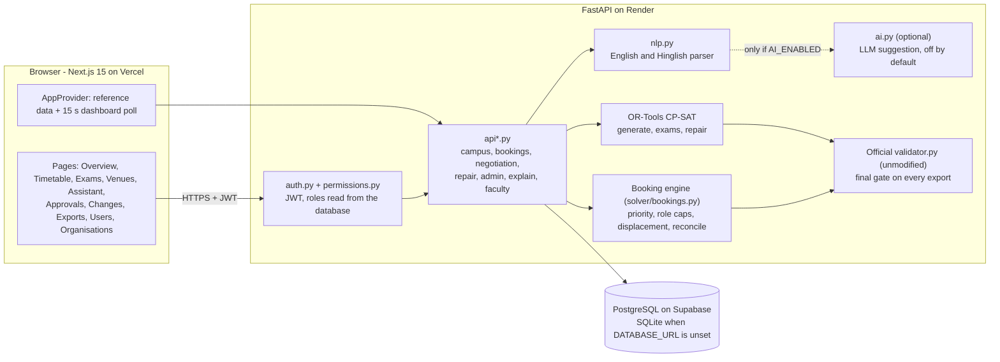
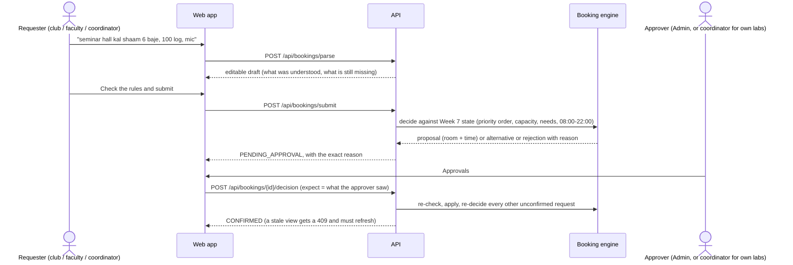
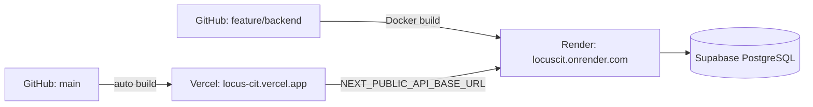

# Architecture

Locus is a web app (Next.js) in front of one API (FastAPI). All scheduling logic lives in the API; the browser only shows state and sends requests.
The same diagram as a picture: [`architecture.svg`](architecture.svg).

## 1. System overview



Validity is always decided by code. The optional LLM only suggests field values for a draft that the user can edit and that the rules check afterwards.

## 2. Request lifecycle: a venue booking



* The requester can never decide their own request.
* A confirmed booking is never taken away silently. To free a slot the requester asks the holder to move (negotiation); the holder agrees, and an approver applies both changes together.
* A request outside the requested window is an *alternative offer*: it needs the requester's acceptance. Declining ends it as rejected.

## 3. Request lifecycle: a timetable change

```mermaid
sequenceDiagram
  actor A1 as Admin (proposer)
  participant W as Web app
  participant API as API
  participant S as CP-SAT repair
  participant V as Official validator
  actor A2 as Admin (reviews and approves)
  A1->>W: upload change file / sample / form
  W->>API: POST /api/disruptions/propose
  API->>S: minimise moved sessions (hard rules kept, soft penalty kept)
  S-->>API: new timetable + proof of the minimum
  API->>V: validate against the dataset, baseline and change
  V-->>API: hard 0, soft, sessions moved
  API-->>W: before/after of every moved session. Nothing applied yet.
  A2->>W: Approve and apply
  W->>API: POST /api/proposals/{id}/approve
  API->>V: re-check on the live timetable
  API-->>W: applied; schedule_after.json is exportable
```

## 4. What is stored

| Table | Content |
| --- | --- |
| `users` | accounts: hashed password, role, link to faculty / department / club, active flag, must-change-password flag |
| `organisations` | the clubs, departments and institute offices that requests are made for |
| `workspace` | one versioned JSON document: current timetable, exam schedule, applied changes, booking requests and decisions, negotiations, notifications, and the timetable as it was before the first applied change (served as `schedule.json`) |
| `audit` | who did what and when |

## 5. Modules

| Layer | Path | Responsibility |
| --- | --- | --- |
| API | `backend/app/main.py`, `api*.py` | routes, request validation, role checks |
| Security | `auth.py`, `permissions.py`, `accounts.py` | login, JWT, role rules, temporary passwords |
| Solvers | `solver/generate.py`, `exams.py`, `repair.py`, `soft.py` | CP-SAT models for the timetable, exams and minimal-change repair |
| Booking | `solver/bookings.py`, `api_bookings.py`, `api_negotiation.py` | priority rules, conflicts, move offers |
| Language | `nlp.py`, `ai.py` | English/Hinglish parsing; optional LLM assist |
| Data | `core/dataset.py`, `core/official.py`, `db.py`, `state.py` | dataset loading, the official validator bridge, persistence |
| Web | `frontend/components/*`, `frontend/lib/*` | one folder per page, shared API client and app context |

## 6. Deployment



Settings are listed in [`.env.example`](../.env.example); the deployment steps are in [DEPLOY.md](DEPLOY.md).
